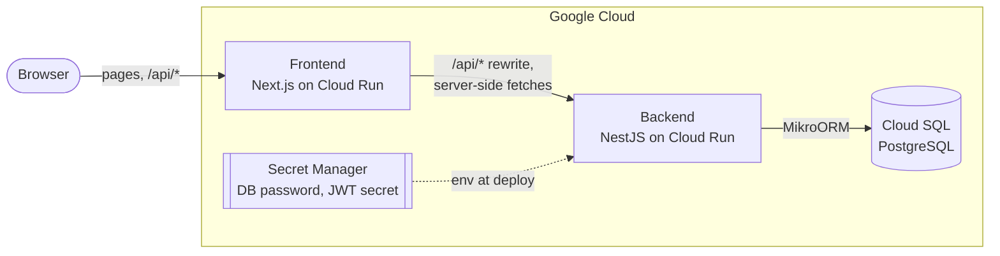

# Meet Poll

A Doodle-style scheduling-poll app: an organizer proposes candidate meeting
times, invitees vote **Yes / No / If-need-be** on each one, and the app
surfaces the slot where the most people can attend.

Live: <https://meet-poll-frontend-kwemjs3vna-ew.a.run.app>

## How it works

1. Sign up (email + password) and create an event: a title and a few
   candidate slots, entered in your own time zone.
2. Share the event link. Anyone with an account and the link can vote on
   each slot; votes save on click and the tallies update.
3. Slots are ranked by how many people can attend (yes + if-need-be), ties
   broken by yes votes. The organizer picks the final time, which closes
   voting.

## Architecture



- The browser talks only to the frontend origin; `/api/*` is rewritten to
  the backend, so the httpOnly session cookie stays first-party.
- Server components fetch from the backend directly, forwarding the
  visitor's cookie. The API contract is the committed `openapi.json`, from
  which the frontend's client types are generated.
- The backend is plain NestJS feature modules (`auth`, `users`, `events`)
  with MikroORM; errors are RFC 9457 problem details. Migrations run on
  startup under an advisory lock.
- Schema: `users` ← `identities` (password now, Google later), `users` ←
  `events` ← `time_slots` ← `votes` (one per slot and voter), plus the
  event's nullable `finalized_slot_id`.

## Tech stack

**Frontend** — `apps/frontend`

- [Next.js](https://nextjs.org/) (App Router)
- [MUI](https://mui.com/) v9 + [Tailwind CSS](https://tailwindcss.com/) v4, combined via CSS cascade layers

**Backend** — `apps/backend`

- [NestJS](https://nestjs.com/)
- PostgreSQL via MikroORM, in plain NestJS feature modules

**Shared tooling**

- [Bun](https://bun.sh/) as the runtime and package manager for both apps
- Bun workspaces + [Turborepo](https://turborepo.com/) for the monorepo
- [oxlint](https://oxc.rs/) + [oxfmt](https://oxc.rs/) for linting/formatting
- `bun test` for unit and API (real Postgres) tests, Playwright for browser tests
- Docker Compose for local Postgres

**Infra & deployment**

- [Terraform](https://www.terraform.io/) on Google Cloud (Cloud Run, Cloud SQL, Artifact Registry, Secret Manager, IAM, Workload Identity Federation)
- GitHub Actions: checks, migration drift and OpenAPI drift checks, and
  Playwright browser tests on every PR; on `main`, Terraform plan/apply
  (with approval) and image build + Cloud Run deploy with a smoke test

## Running locally

Requires [Bun](https://bun.sh/) and Docker.

```bash
bun install
cp apps/backend/.env.example apps/backend/.env
cp apps/frontend/.env.example apps/frontend/.env.local

# Postgres — localhost:5432 (user/password/db: meetpoll)
docker compose up -d --wait

# backend — http://localhost:3001 (applies pending migrations on start)
bun run dev:be

# frontend — http://localhost:3000
bun run dev:fe
```

If port 5432 is taken, pick another host port with
`POSTGRES_PORT=5433 docker compose up -d --wait`. `docker compose down -v`
stops Postgres and wipes its data.

## Tests

```bash
bun run test                                  # unit tests, both apps
bun run test:e2e                              # backend API tests against Postgres
bun run --filter frontend test:browser        # Playwright, full stack
```

Each app's README has more detail: [backend](apps/backend/README.md),
[frontend](apps/frontend/README.md).
